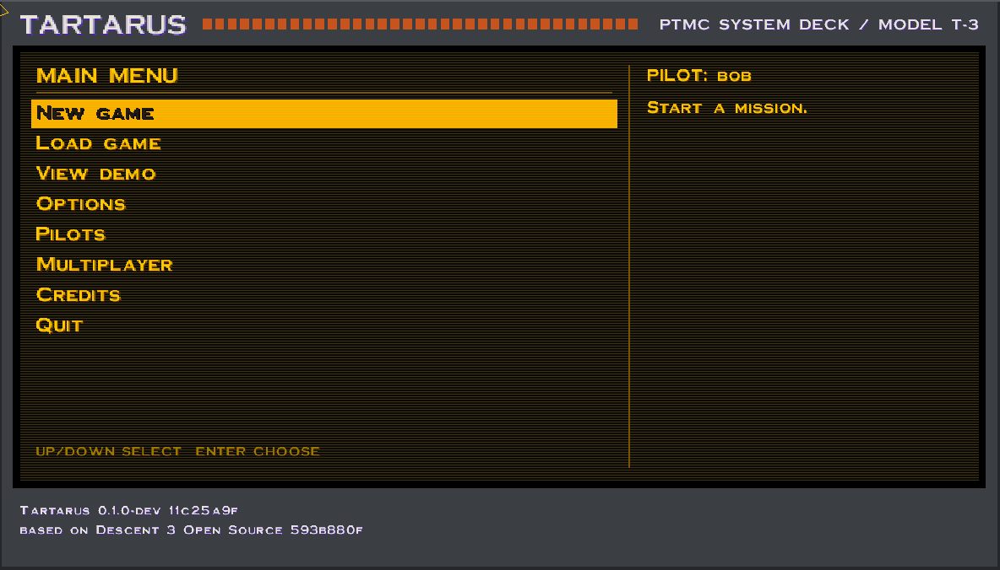
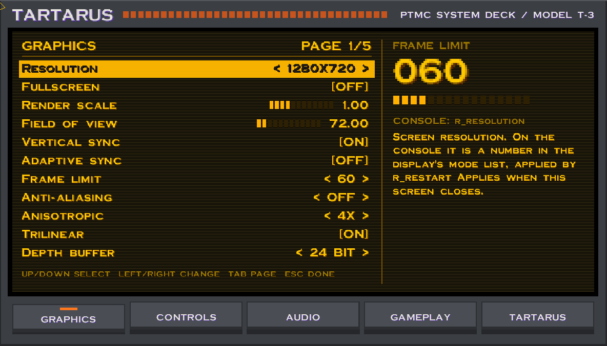
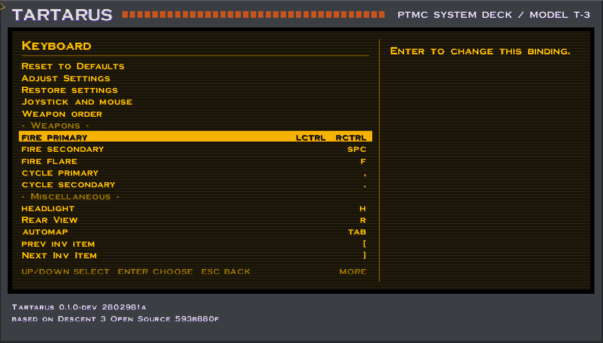
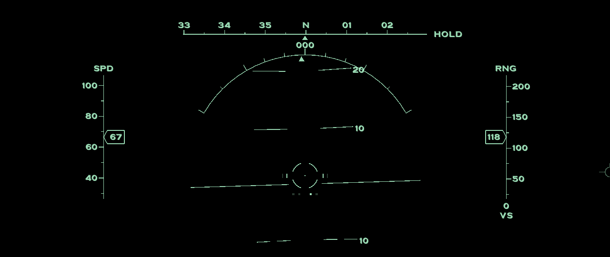
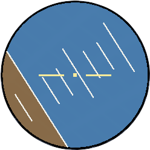
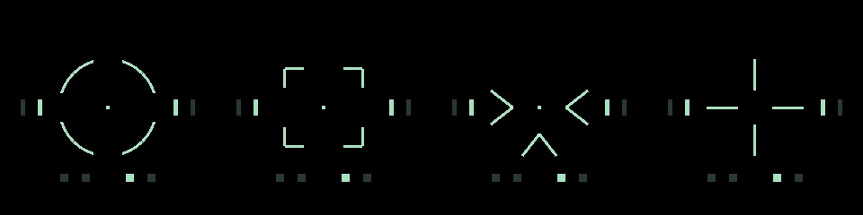
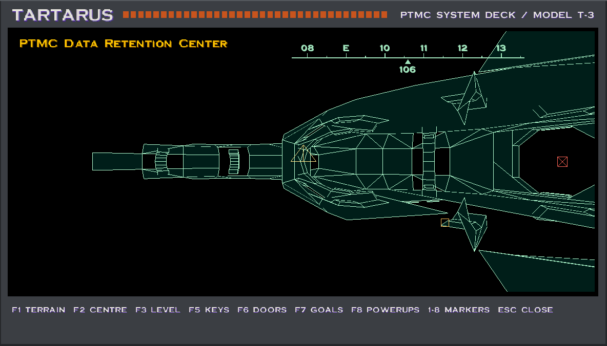

> **Status:** Active
> **Provenance:** Shane Hartley (project owner, design); Claude (initial documentation scaffolding, 2026-11-01)
> **Last reviewed:** 2026-11-04
> **Why this status:** In development. Upstream is merged and the game plays from a Steam install; Phases 0 and 1 of ROADMAP.md are closed apart from listed deferrals, and Phase 2 (controls and display) is under way.

# Tartarus — a tactical Descent 3 for Linux

*Working title; see D-002.*

Tartarus is a Linux-first fork of the open-source Descent 3 engine ([DescentDevelopers/Descent3](https://github.com/DescentDevelopers/Descent3), GPL-3.0). It keeps the original game intact behind a **Classic Mode** switch and layers on a set of *tactical* additions that exploit Descent's six-degrees-of-freedom tunnels rather than simply adding bigger guns: a player-triggered cloak, a gravity missile that drags enemies round corners, orientation aids for pilots who lose track of "up", an overhauled automap, a proper developer console, and a password-gated cheat menu. It is for people who own Descent 3 (Steam or otherwise) and want it to run natively and well on Linux, and for anyone who wants a modern, scriptable sandbox on top of the 1999 engine.

Tartarus is an engine fork only. It does **not** include any Descent 3 game data; you need your own copy of the game.

## The deck

Tartarus replaces the stock menus with a cassette-futurism "deck": amber phosphor on a gunmetal casing, drawn at your screen's resolution. Classic Mode keeps the original menus.





The deck covers the whole game in Tartarus mode: the main menu, saving and loading, pilots, new game and in-game prompts, and all the controls, with every key, joystick and mouse binding, weapon order and settings in one style.



## Flight HUD

In cockpit view a pale green head-up display sits on the canopy, behind the cockpit frame, so it looks as if it is on the glass. Everything lines up with the real world at any field of view.



*Shown on a plain background so the picture contains no game artwork.*

- **Horizon and pitch ladder** tilt and move with the ship, so you can always see which way is up.
- **Flight path marker** shows where the ship is actually going, which in a craft that slides sideways is often not where the nose points. A cross through it means you are moving backwards.
- **Heading tape and roll arc** give a compass bearing and how far you are rolled.
- **Speed and wall range** run down either side: range is the distance to the first wall or closed door along your nose. Climb rate sits beneath.
- **Status words** such as HOLD, SNAP, SLIDE and BOOST appear beside the tape only while active.

Every part has its own switch on the deck's Gameplay page, one setting turns them all off, and the HUD can be shown without the cockpit too.

## Staying upright

Hold **X** to roll upright, or tap **Z** to roll to the nearest upright. Any roll input of your own cancels them. Both work as ordinary bank input, so the stock physics are untouched. Optional aids can also be switched on: a wedge on the reticle that points to world up, an axis gizmo and this attitude ball, each with adjustable size, position and transparency.



## Reticles

A choice of four drawn reticles: Gunsight, Brackets, Chevrons and Cross. The stock reticle is still available. In all of them, the bars at the sides show your primary guns and the pips underneath show your missile launchers, placed by side, and bright means ready to fire.



## The automap

The ship has a laser scanner. As you fly, it reaches surfaces within 200 units and builds the map, so you only know what you have been close enough to scan. Everything else is blank, and fly-throughs leave gaps until you go back for a proper look.



- **Wireframe** pale green lines on black at full resolution, with a compass and an amber marker for your ship. Surfaces new since you last looked flash when the map opens.
- **Symbols** show doors (red when locked), keys, goals and powerups in places you have scanned, each with its own filter key. Robots are never shown.
- **Saved** with your game, in a small file beside each save.
- **Getting your bearings:** when you close the map, the roll arc and heading tape stand out for a moment.

Classic Mode has none of this: it keeps the stock menus, reticle, map and flying.

## Credits and licence

Descent 3 was created by Outrage Entertainment and published by Interplay (1999). The source was released under GPL-3.0 on 16 April 2024 and is maintained by the DescentDevelopers community; Tartarus would not exist without their 64-bit, SDL and CMake modernisation work. Upstream's `THIRD_PARTY.md` is carried forward unchanged. See [LICENSE](LICENSE) (GPL-3.0, inherited — see D-003).

## Quick start

```bash
# 1. Clone (submodules carry third-party code)
git clone --recurse-submodules https://github.com/Darian-Frey/tartarus
cd tartarus

# 2. Build (Linux preset; see BUILD.md for dependencies)
cmake --preset linux
cmake --build --preset linux --config Release

# 3. Run. A Steam install of Descent 3 is found automatically; otherwise
#    add -additionaldir "<path to your Descent 3 install>" (BUILD.md §4)
./builds/linux/build/Release/Descent3
```

The first launch runs in Classic Mode. Open the console with the backtick key (`` ` ``) and type `classic 0` to enable Tartarus features, or toggle it in Options → Tartarus.

## Build requirements

Linux x86-64 (primary; Linux Mint 22 / Ubuntu 24.04 is the reference machine), CMake ≥ 3.20, Ninja, GCC ≥ 13 or Clang ≥ 17, SDL3 ≥ 3.2.6, zlib, glm, plog, gtest, cpp-httplib, libxcrypt. Dependencies can come from the distro or from vcpkg exactly as upstream. Full detail in [BUILD.md](BUILD.md).

## Project structure

```
tartarus/
├── Descent3/            Game module (upstream layout preserved)
│   └── tartarus/        All Tartarus additions live here — see ARCHITECTURE.md
├── physics/ renderer/ … Upstream engine modules (modified only where listed in ARCHITECTURE.md §Hook points)
├── data/tartarus/       Sidecar data shipped with the fork (weapon definitions, HUD layouts; no Outrage assets)
├── docs/                Design notes that are too long for the standard documents
├── tools/               Scripts (cross-ref checker, upstream-sync helper)
└── *.md                 Standard documents (below)
```

## Documentation map

| Document | What it answers |
|----------|-----------------|
| [FEATURES.md](FEATURES.md) | What Tartarus does, with priorities and acceptance criteria (F-NNN) |
| [ROADMAP.md](ROADMAP.md) | Which phase delivers which features |
| [ARCHITECTURE.md](ARCHITECTURE.md) | Where the new code sits and how it hooks into the upstream engine |
| [DECISIONS.md](DECISIONS.md) | Why it is built this way (D-NNN) |
| [SPEC.md](SPEC.md) | Constants, formulas, console grammar, cheat passwords, data formats |
| [ATTACK_VECTORS.md](ATTACK_VECTORS.md) | How it could break, and how each failure is detected (AV-NNN) |
| [BUGS.md](BUGS.md) / [IMPROVEMENTS.md](IMPROVEMENTS.md) | Realised defects / candidate refactors (BUG-NNN, IMP-NNN) |
| [BUILD.md](BUILD.md) | Toolchain, dependencies, build and run commands |
| [CHANGELOG.md](CHANGELOG.md) | What changed, when |
| [CLAUDE.md](CLAUDE.md) | Handoff for AI-assisted sessions |

## License

GPL-3.0 — see [LICENSE](LICENSE). Game data is the property of its rights holders and is never distributed with this project.
